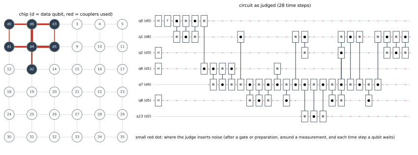

# 메인 해커톤 — 원하는 state를 더 정확하게

**Qiskit Fall Fest 2026 @ SNU**

Quantum computing에서는 알고리즘의 입력이나 연산에 필요한 state를 준비하는 일이 많습니다.
이번에는 아래에 주어진 **7-qubit state를 만드는 회로**를 설계합니다.
Noise가 없을 때 목표 state를 정확히 만들고, noise가 있어도 목표에 가까운 state를 만드는 것이 목표입니다.

이 문서는 **메인 해커톤의 문제와 채점 규칙**입니다. 입문용 **튜토리얼 미션 1·2**는
[`tutorial.ipynb`](tutorial.ipynb)에 있습니다. 튜토리얼 미션을 완료하지 않아도 메인 해커톤에 참여할 수 있습니다.

**AI 사용:** ChatGPT, Claude, GitHub Copilot 등 AI 도구를 자유롭게 사용해도 됩니다.
개념 학습, 코드 작성·수정, 디버깅, 회로 설계 등 모든 과정에서 사용할 수 있습니다.

## 0. 만들고 싶은 state

### 0.1 목표

출력 qubit 7개를 $q_0,\ldots,q_6$이라 합시다. 다음 state를 준비하세요.
**Ket의 순서는 Qiskit과 같은 $|q_6q_5\cdots q_0\rangle$입니다.**

$$
\begin{aligned}
|\psi_{\mathrm{target}}\rangle={}&\frac14\bigl(
|0000000\rangle+|0011110\rangle+|0101101\rangle+|0110011\rangle\\
&\qquad+|1001011\rangle+|1010101\rangle+|1100110\rangle+|1111000\rangle\bigr)\\
&+\frac{e^{i\pi/4}}4\bigl(
|0000111\rangle+|0011001\rangle+|0101010\rangle+|0110100\rangle\\
&\qquad+|1001100\rangle+|1010010\rangle+|1100001\rangle+|1111111\rangle\bigr).
\end{aligned}
$$

표시하지 않은 항의 amplitude는 모두 0입니다. 16개 항의 측정 확률은 각각 $1/16$이지만,
**확률분포뿐 아니라 상대위상도** 맞아야 합니다. State 전체에 공통으로 붙는 global phase는 무관합니다.

이 state를 $|T_L\rangle$이라고도 부릅니다. 아래 배경 설명은 선택 사항입니다.
먼저 문제 설정을 읽고 [예시 회로](#4-시작용-예시-회로)를 실행해도 됩니다.

<details>
<summary>이 state는 어디에 쓰이나요? — Magic state와 Steane code</summary>

일부 quantum computing 방식에서는 특정 state를 미리 준비해 두었다가 연산에 사용합니다.
그중 하나가

$$|T\rangle=\frac{|0\rangle+e^{i\pi/4}|1\rangle}{\sqrt2}$$

라는 **magic state**입니다. Clifford 연산과 함께 사용하면 T gate를 구현할 수 있습니다 [1].
이번 목표 state는 이 magic state를 7개 qubit에 encoding한 것입니다.

### 0.2 목표 state의 구조

**Steane $[[7,1,3]]$ code** [6]는 physical qubit 7개에 logical qubit 하나를 담고,
임의의 단일-qubit Pauli error를 정정할 수 있는 quantum error-correcting code입니다.
두 logical basis state를 전개하면 다음과 같습니다. Ket 순서는 0.1절과 같습니다.

$$
\begin{aligned}
|0_L\rangle=\frac{1}{\sqrt8}\bigl(
&|0000000\rangle+|0011110\rangle+|0101101\rangle+|0110011\rangle\\
&+|1001011\rangle+|1010101\rangle+|1100110\rangle+|1111000\rangle\bigr),
\end{aligned}
$$

$$
\begin{aligned}
|1_L\rangle=\frac{1}{\sqrt8}\bigl(
&|0000111\rangle+|0011001\rangle+|0101010\rangle+|0110100\rangle\\
&+|1001100\rangle+|1010010\rangle+|1100001\rangle+|1111111\rangle\bigr).
\end{aligned}
$$

각 state에는 amplitude가 $1/\sqrt8$인 항이 8개 있습니다. 이 둘을 다음처럼 합치면 목표 state가 됩니다.

$$|T_L\rangle=\frac{|0_L\rangle+e^{i\pi/4}|1_L\rangle}{\sqrt2}.$$

(직접 $|T_L\rangle$을 계산해 보세요! 각 항의 계수가 $1/4$ 또는 $e^{i\pi/4}/4$이 되어 0.1절의 식과 같아집니다.)

이 두 basis state의 선형결합으로 이루어진 공간을 code space라고 합니다. Code space는 다음 여섯 operator의
공통 $+1$ eigenspace이기도 합니다. 이 operator들을 $\color{blue}{\text{stabilizer}}$ generator라고 부릅니다.
Code space 안의 state에서는 이들을 이상적으로 측정하면 항상 **+1**이 나오고 state가 바뀌지 않습니다.
측정 결과를 bit로 저장하면 +1은 0, −1은 1에 대응합니다.
일부 오류는 이 결과를 바꾸므로 실행을 선택하는 데 사용할 수 있지만, 모든 오류를 검출하는 것은 아닙니다.
또 여섯 결과가 모두 +1이어도 목표의 logical state와 상대위상까지 맞는다는 보장은 없습니다.
이러한 검사의 목적과 보조 qubit을 이용한 측정 예시는 [`tutorial.ipynb`](tutorial.ipynb)의 Part 3을 참고하세요.

| 묶음 | Qubit 번호 | 두 generator |
|---|---|---|
| $S_1$ | $\{0,2,4,6\}$ | $X_{S_1}, Z_{S_1}$ |
| $S_2$ | $\{1,2,5,6\}$ | $X_{S_2}, Z_{S_2}$ |
| $S_3$ | $\{3,4,5,6\}$ | $X_{S_3}, Z_{S_3}$ |

$X_{S_k}$는 그 묶음의 qubit에만 X를 적용하고, 나머지는 그대로 두는 operator입니다.
Qubit $i$는 이진수 $i+1$에 대응하며, $S_k$는 $k$번째 bit가 1인 qubit들의 집합입니다.

### 0.3 Logical operator와 부호

Code space 안에서 logical X, Z, Y는 다음과 같습니다.

$$X_L=X^{\otimes7},\qquad Z_L=Z^{\otimes7},\qquad
Y_L=iX_LZ_L=-Y^{\otimes7}.$$

마지막 등식에는 $XZ=-iY$를 사용합니다. 따라서 목표 state에서는

$$\langle X_L\rangle=\langle Y_L\rangle=1/\sqrt2,\qquad\langle Z_L\rangle=0.$$

채점기가 이 부호와 기댓값을 처리합니다. 참가자가 직접 계산할 필요는 없습니다.

</details>

## 1. 문제 설정

### 1.1 Hardware

- Qubit **36개**가 **6×6 격자**에 있습니다. Row $r$, column $c$의 번호는 $6r+c$입니다.
- **상하좌우로 이웃한 쌍**에만 2-qubit gate를 적용할 수 있습니다. 대각선과 격자의 양 끝은 연결되지 않습니다.
- 모든 qubit은 처음에 $|0\rangle$입니다. 회로 중간에는 `reset`으로 다시 $|0\rangle$을 준비할 수 있습니다.
  처음 상태와 `reset` 모두 준비 오류가 있습니다(1.5절).
- 목표 state를 담을 7개 qubit의 위치는 자유롭게 정하고, 나머지 qubit도 보조 용도로 사용할 수 있습니다.

| Row / Column | 0 | 1 | 2 | 3 | 4 | 5 |
|---|---|---|---|---|---|---|
| 0 | 0 | 1 | 2 | 3 | 4 | 5 |
| 1 | 6 | 7 | 8 | 9 | 10 | 11 |
| 2 | 12 | 13 | 14 | 15 | 16 | 17 |
| 3 | 18 | 19 | 20 | 21 | 22 | 23 |
| 4 | 24 | 25 | 26 | 27 | 28 | 29 |
| 5 | 30 | 31 | 32 | 33 | 34 | 35 |

### 1.2 허용 연산

회로는 **Qiskit**으로 만듭니다. 아래 이름은 `QuantumCircuit` 메서드와 OpenQASM 2.0의 연산 이름입니다.

| 종류 | 연산 |
|---|---|
| 1-qubit | `id`, `x`, `y`, `z`, `h`, `s`, `sdg`, `sx`, `sxdg`, `t`, `tdg` |
| 2-qubit | `cx` |
| 측정·리셋 | `measure` (Z 기저), `reset` ($\lvert0\rangle$ 준비) |
| 시점 지정 | `barrier` (1.5절의 기다림 noise에 영향) |

- 2-qubit gate는 **`cx`만** 사용하며, 인접한 qubit 쌍에만 적용할 수 있습니다.
  `swap`, `cz` 등이 필요하면 `cx`와 1-qubit gate로 구성하세요. Qiskit `transpile`에 `basis_gates`로
  `cx`만 주면 자동으로 분해됩니다.
- `ccx`, `ccz` 등 3-qubit gate, `rx`, `u`, `p` 등 회전 gate, 직접 정의한 gate, 조건부 연산(`if`)은 허용하지 않습니다.
  필요한 동작은 허용된 연산으로 구성하세요.
- X 기저 측정은 `h` 다음 `measure`, $|+\rangle$ 준비는 `reset` 다음 `h`로 작성합니다. 채점기는 이 쌍을
  **X 기저 측정·준비 한 번**으로 처리합니다. 이때 `h`에는 noise와 시간이 붙지 않습니다.
  측정한 qubit을 `reset` 없이 다시 쓰려면 `h`, `measure`, `h`로 쓰세요. 세 연산이 X 기저 측정 한 번이며,
  qubit은 측정 결과에 해당하는 $|+\rangle$ 또는 $|-\rangle$에 남습니다. 그 밖의 경우 `h`는 일반 gate입니다.
- 여러 qubit의 Pauli 곱을 직접 측정하는 연산은 없습니다. 필요하면 보조 qubit과 허용 gate로 구성하세요.

### 1.3 회로와 측정 기록 작성

제출 회로는 **OpenQASM 2.0 텍스트**입니다. `tprep.submission_text(qc)`로 만들 수 있습니다.
실행을 선택하거나 출력의 logical Pauli를 지정하려면 다음 주석을 덧붙입니다.

| 주석 | 의미 |
|---|---|
| `// DETECTOR c[0] c[2]` | 두 bit의 XOR가 noise 없는 실행의 기준값과 같을 때만 accept |
| `// POSTSELECT(0) c[0] c[2]` | 두 bit의 XOR가 0일 때만 accept |
| `// POSTSELECT(1) c[0]` | 해당 bit가 1일 때만 accept |
| `// FRAME_X(0) c[0]` | logical X 보정값 $f_X=c[0]$ |
| `// FRAME_Z(1) c[1] c[2]` | logical Z 보정값 $f_Z=1\oplus c[1]\oplus c[2]$ |

- 양자 레지스터는 하나만 선언합니다. `q[i]`는 칩의 physical qubit $i$입니다. 36개보다 작게 선언해도 됩니다.
- 같은 classical bit에 여러 번 측정했다면 **마지막 측정 결과**를 사용합니다. 이전 결과도 필요하면 다른 bit에 저장하세요.
- DETECTOR의 기준값은 채점기가 찾습니다. Noise 없이 항상 1인 패리티도 사용할 수 있습니다.
- POSTSELECT는 noise가 없어도 무작위인 측정 결과를 선택할 때 사용할 수 있습니다.
- FRAME의 괄호 안 값과 뒤에 적은 bit들의 XOR가 보정값입니다. Bit 없이 상수만 적어도 됩니다.
  `FRAME_X`와 `FRAME_Z`는 각각 한 번씩 선언하거나, 둘 다 생략합니다.
- 이 주석들은 Qiskit에는 일반 주석이며, 채점기가 읽습니다. Qiskit 회로로 다시 읽고 저장하면 주석이 사라질 수 있습니다.

다음은 문법을 보여 주는 작은 예시입니다. 목표 state 준비 회로는 아닙니다.

```python
from qiskit import QuantumCircuit
import tprep

qc = QuantumCircuit(3, 2)
qc.measure(1, 0)
qc.measure(2, 1)
text = tprep.submission_text(
    qc, detectors=[[qc.clbits[0]], [qc.clbits[0], qc.clbits[1]]]
)
print(text)
```

텍스트 마지막에 다음 두 줄이 붙습니다.

```text
// DETECTOR c[0]
// DETECTOR c[0] c[1]
```

출력의 logical Pauli와 선언 방법은 2.1절, Python 사용 예시는 5.3절을 참고하세요.

### 1.4 채점기가 처리할 수 있는 회로

허용 gate만 썼더라도 **채점기(xtim)가 처리할 수 있는 회로**여야 합니다.
지원 범위를 벗어나 `XtimRejectError` 등이 발생하면 해당 제출은 유효하지 않습니다.
회로를 수정할 때 로컬에서 `tprep.check`를 실행해 확인하세요.

<details>
<summary>시뮬레이션 제약의 자세한 설명</summary>

채점기는 Clifford 연산을 통과시켜 표현했을 때 서로 commute하는 $\pi/8$ Pauli rotation 한 층으로
정리되는 회로를 대상으로 합니다. 허용 gate를 임의로 이어 붙인 모든 회로를 처리하지는 않습니다.

- 서로 다른 qubit에 병렬로 T gate를 적용하는 구조는 사용할 수 있습니다.
- 비-Clifford gate 사이에 H가 들어가는 구성은 지원 범위를 벗어날 수 있습니다.
  예를 들어 `H · T · H · T · H`는 거부됩니다.
- 여러 단계의 distillation을 결합하면 거부될 수 있습니다.

특정 구조가 가능한지는 최종적으로 `tprep.check`의 `class` 검사로 확인하세요.

</details>

### 1.5 Noise model

채점기가 다음 noise를 삽입합니다. **참가자는 회로에 noise를 직접 넣지 않습니다.**
공식 채점의 오류 확률은 $p=10^{-3}$이며, uniform depolarizing circuit noise를 사용합니다.

| 위치 | Noise |
|---|---|
| 모든 1-qubit gate 직후 (`id`, `t`, `tdg` 포함) | 확률 $p$로 X, Y, Z 중 하나를 균등하게 적용 |
| 모든 `cx` 직후 | 확률 $p$로 II를 제외한 15개 2-qubit Pauli 중 하나를 균등하게 적용 |
| 모든 준비 직후: `reset`, `reset`+`h`, 그리고 각 qubit을 처음 사용할 때 | 확률 $p$로 직교 상태 ($\lvert1\rangle$ 또는 $\lvert-\rangle$) |
| 모든 측정: `measure`, `h`+`measure` | 확률 $p$로 결과가 뒤집히고, 측정 직후 확률 $p$로 X, Y, Z 중 하나 |
| 기다리는 qubit | 기다리는 time step마다 확률 $p$로 X, Y, Z 중 하나 |

이 밖에는 noise가 없습니다. **기다리는 동안에도 오류가 생기므로, 회로가 깊을수록 불리합니다.**

<details>
<summary>Time step과 기다림을 세는 방법 보기</summary>

- 모든 연산은 time step 하나를 차지합니다. 연산은 **쓴 순서대로**, 해당 qubit들이 모두 비는 가장 이른 time step에
  실행됩니다. 서로 다른 qubit의 연산은 같은 time step에 병렬로 실행될 수 있습니다.
- Qubit은 자신의 두 연산 사이, 그리고 마지막 연산부터 회로 끝까지 기다립니다. 다음은 기다림으로 세지 않습니다.
  - 처음 사용하기 전 (보조 qubit은 필요할 때 처음 사용하면 됩니다)
  - `reset` 직전
  - 측정한 뒤 다시 사용하지 않는 qubit
- `barrier`는 Qiskit과 같은 뜻입니다. `barrier`로 묶인 qubit들의 다음 연산은 그 qubit들의 앞선 연산이 모두
  끝난 뒤에 시작합니다. 예를 들어 `barrier q[2],q[20];` 다음의 `reset q[20];`은 q[2]의 앞선 연산이 끝난 뒤
  실행되므로, 일찍 쓰여 있어도 q[20]이 미리 준비되어 기다리지 않습니다.
- `tprep.draw`는 채점기와 같은 time step으로 회로를 그리고, 기다리는 칸마다 noise 위치를 표시합니다(4.4절).

</details>

### 1.6 실행을 받아들이는 조건

**모든 POSTSELECT 조건을 만족하고, 모든 DETECTOR의 패리티가 기준값과 같은 실행만** 받아들입니다(**accept**).
나머지 실행은 버립니다(**post-selection**). 두 종류의 조건을 모두 생략하면 모든 실행을 받아들입니다.

DETECTOR는 noise 없는 실행에서 패리티가 항상 같아야 합니다. POSTSELECT를 사용한다면,
**그 조건을 만족하는 실행들 안에서** 항상 같으면 됩니다. 기준값은 0 또는 1이며 채점기가 찾습니다.
Noise 없이도 무작위인 패리티를 직접 선택하려면 DETECTOR 대신 POSTSELECT를 쓰세요.

Noise 없는 실행에서도 일부를 버릴 수 있지만, 받아들일 수 있는 실행이 있어야 합니다.
또한 너무 많은 실행을 버리지 않도록 **$p=10^{-3}$에서 acceptance가 0.5 이상**이어야 합니다.
채점용 최종 정정 절차는 실행을 버리는 데 사용하지 않습니다.

## 2. 채점

### 2.1 제출 유효성

다음 검사를 순서대로 통과해야 점수를 받습니다. 하나라도 실패하면 유효하지 않은 제출로 처리하며, 순위에서 제외합니다.

| 출력 | 확인하는 내용 |
|---|---|
| `format` | OpenQASM 2.0, qubit 범위, 허용 연산, 이웃 연결, 측정 기록 선언 및 `data_qubits` |
| `class` | 채점기(xtim)가 처리할 수 있는 회로인지 |
| `correctness` | Noise 없이 accept된 실행의 출력이 아래 조건을 만족하고, DETECTOR가 결정적인지 |
| `acceptance` | Noise가 있을 때 acceptance가 0.5 이상인지 |

**Noise 없이 accept된 실행에서는 출력이 $|T_L\rangle$이어야 합니다.**
다만 측정 기록으로 어떤 logical Pauli가 붙었는지 알 수 있다면 다음 출력도 허용합니다.

$$X_L^{f_X}Z_L^{f_Z}|T_L\rangle,\qquad f_X,f_Z\in\{0,1\}.$$

즉 $|T_L\rangle$, $X_L|T_L\rangle$, $Y_L|T_L\rangle$, $Z_L|T_L\rangle$ 중 어느 것인지
기록으로 구분할 수 있으면 됩니다. Global phase는 무관합니다.
채점기는 그 기록을 바탕으로 logical Pauli를 보정해 점수를 계산합니다.
예를 들어 출력이 $X_L|T_L\rangle$이고 그 사실을 기록으로 알 수 있다면,
$X_L$을 한 번 더 적용해 목표로 되돌릴 수 있으므로 버릴 필요가 없습니다.
이러한 보정 정보를 **Pauli frame**이라고 부릅니다.
DETECTOR와 POSTSELECT는 어떤 실행을 남길지, FRAME은 남긴 출력을 어떻게 보정할지 정합니다.
[`tutorial.ipynb`](tutorial.ipynb)의 Part 3에서 GHZ를 이용한 예시를 볼 수 있습니다.

보정값은 상수와 측정 결과들의 XOR로 지정합니다. 예를 들어 출력이 $Z_L^m|T_L\rangle$이고
$m$을 `c[0]`에 저장했다면 다음과 같이 선언합니다.

```text
// FRAME_X(0)
// FRAME_Z(0) c[0]
```

**FRAME을 선언하면 채점기는 그 선언을 그대로 사용합니다.** 두 선언을 모두 생략하면 자동으로 찾습니다.
자동 추출이 보정값을 찾지 못하는 회로에서는 직접 선언하세요.
Noise가 없을 때 같은 값을 내는 두 측정도 noise가 있을 때는 달라질 수 있으므로,
어떤 측정 기록을 보정에 쓸지는 점수에 영향을 줄 수 있습니다.

실제 양자 오류정정에서도 Pauli 보정을 고전 기록으로 관리하고 이후 연산이나 결과 해석에 반영할 수 있습니다.
이 문제에서는 조건부 gate를 허용하지 않으므로, 측정에 따른 logical Pauli 보정은 이 방식으로 지정합니다.

정답 조건은 **accept된 실행**에 적용합니다. 버려지는 실행의 출력은 목표 state일 필요가 없습니다.
다만 accept된 실행에서는 logical Pauli 보정 후, **채점기의 최종 정정 없이 이미 목표 state**여야 합니다.
다른 상대위상이나 잘못된 output 순서, code space 밖의 state는 통과하지 못합니다.
측정 결과에 따른 $S_L$ 등의 보정도 허용하지 않습니다.

측정 기록은 실행 선택과 Pauli frame에 함께 사용할 수 있습니다. 출력과 무관한 측정에 frame 역할을
지정할 필요는 없습니다.

### 2.2 점수: 최종 정정 후 infidelity

점수는 **$1-F$이며 작을수록 좋습니다.** 채점 과정은 다음과 같습니다.

1. 참가자가 정한 DETECTOR와 POSTSELECT 조건으로 accept된 실행을 선택합니다.
2. 출력 7개 qubit에 **채점기가 제공하는 noise 없는 최종 정정 절차**를 적용합니다.
3. 측정 기록으로 정해지는 logical Pauli 보정도 반영해, 목표 state와의 fidelity $F$를 계산합니다.

**최종 정정을 거친 state와 목표 state를 비교해 점수를 계산합니다.**
최종 정정은 출력에 남은 임의의 단일-qubit Pauli error를 고칠 수 있습니다.
여러 qubit의 오류는 종류와 위치에 따라 정정 후에도 목표 state를 바꿀 수 있습니다.

<details>
<summary>최종 정정과 점수의 수학적 정의</summary>

1. §0.2의 $\color{blue}{\text{stabilizer}}$ generator 6개를 noise 없이 측정합니다.
2. $Z_{S_1},Z_{S_2},Z_{S_3}$의 결과가 $(-1)^{s_1},(-1)^{s_2},(-1)^{s_3}$이면
   $s=s_1+2s_2+4s_3$으로 읽습니다. $s\ne0$이면 output qubit $s-1$에 X를 적용합니다.
3. X-type generator의 결과에도 같은 방식으로 Z 정정을 적용합니다.
4. Pauli frame 보정을 반영한 logical 기댓값으로 fidelity를 계산합니다.

$$F=\frac12\left(1+\frac{\langle X_L\rangle+\langle Y_L\rangle}{\sqrt2}\right),
\qquad\mathrm{score}=1-F.$$

평균은 accept된 실행에 대해서만 취합니다. $Y_L=-Y^{\otimes7}$의 부호도 채점기가 처리합니다.

이 절차는 code가 정정할 수 있는 출력 오류와, 정정 후에도 남는 오류를 구분합니다.
Ideal correction/decoding을 기준으로 성능을 평가하는 배경은 [3–5]을 참고하세요.

</details>

### 2.3 순위와 통계 오차

- 점수를 **유효숫자 3자리**로 비교하며 작은 쪽이 앞섭니다.
- 같으면 2-qubit 이상 gate 수가 적은 쪽, 그다음 먼저 제출한 쪽이 앞섭니다.
- 공식 채점은 **seed 0, $10^8$ shots**입니다. $10^6$ shots씩 나누어 $k$번째 묶음에 seed $k$를 사용합니다.
- 같은 채점기 빌드와 환경에서 `tprep.check(..., shots=10**8, seed=0)`으로 공식 설정을 재현할 수 있습니다.

점수는 Monte Carlo 추정값입니다. Seed를 고정하면 재현할 수 있지만 통계 오차가 없어지는 것은 아닙니다.
`check()`는 점수와 표준오차를 `±`로 표시합니다. 점수가 작은 회로일수록 충분한 shots로 확인하세요.
점수가 작을수록 상대 오차가 커서, $1-F$가 $10^{-4}$ 근처라면 공식 설정에서도 셋째 자리 한 칸 정도의 차이는
회로 성능보다 통계 오차일 수 있습니다.
기본값인 $10^6$ shots는 초기 비교에 사용할 수 있으며, 공식 순위는 공식 설정으로 계산한 점수를 따릅니다.

## 3. 제출

[메인 해커톤 제출 페이지](https://snuquantums.github.io/snu-qff2026/submit.html)에서 다음 두 가지를 제출합니다.

1. **회로:** OpenQASM 2.0 텍스트와 필요한 `// DETECTOR`, `// POSTSELECT`, `// FRAME_X`, `// FRAME_Z` 주석.
2. **`data_qubits`:** output qubit $q_0,q_1,\ldots,q_6$이 놓인 physical qubit 번호를 이 순서로 적은 목록.

예를 들어 `data_qubits = [0, 6, 13, 2, 7, 8, 1]`이면 목표 식의 $q_0$은 칩의 0번,
$q_1$은 6번, $q_6$은 1번입니다. **Ket 문자열에서는 $q_0$이 오른쪽 끝이지만, 목록에서는 첫 번째입니다.**
번호 7개는 서로 달라야 합니다.

회로는 **200 KB, 명령 5,000개 이하**여야 합니다. 200 KB는 UTF-8 기준 200,000 바이트이고, 명령 수는 `//` 주석을
뺀 QASM 문장(`;`)의 개수입니다. 넘으면 형식 검사(`format`)에서 유효하지 않은 제출이 됩니다. 로컬 `tprep.check` 도
같은 검사를 합니다. 또 `measure` 와 `reset` 은 합쳐서 **1,000개 이하**여야 합니다. 채점기가 이 둘마다 새 qubit을
하나씩 써서 계산하므로, 이보다 많으면 채점 시간이 감당할 수 없게 늘어납니다.

채점 서버의 제출당 시간 제한은 **30분**입니다. 시간을 넘긴 제출은 "오류"로 기록되고 순위에 들어가지 않으며,
운영진이 확인합니다.

**제출은 팀당 10분에 한 번**입니다. 또 이전 제출이 아직 대기 중이거나 채점 중이면 새로 제출할 수 없습니다.
제출 사이트의 "내 제출 결과"에서 각 제출의 ID, 대기열 순서, 결과와 다음 제출까지 남은 시간을 볼 수 있습니다.
공식 채점과 같은 빌드와 환경에서 `tprep.check(..., shots=10**8, seed=0)`으로 공식 설정을 재현할 수 있습니다.
회로를 다듬는 반복은 로컬에서 진행하세요.
순위표는 행사 안내에 따라 공개됩니다.

## 4. 시작용 예시 회로

<details>
<summary>예시 회로와 개선 방법 보기</summary>

처음에는 아래 회로를 실행해 보세요. **예시에서 시작해 회로와 배치를 수정해도 됩니다.**

Qiskit의 `prepare_state`로 목표 amplitude에서 준비 회로를 자동 생성할 수도 있습니다.
[`tutorial.ipynb`](tutorial.ipynb)의 Part 4에서 사용법과 생성된 회로를 볼 수 있습니다.
다만 자동 생성 회로에는 허용되지 않는 일반 회전 gate가 들어갈 수 있습니다.
아래 예시는 목표의 구조를 이용해 H, T, CNOT만으로 준비하는 회로입니다.

### 4.1 목표 state 만들기

다음 회로는 연결 제약을 적용하기 전의 7-qubit 회로입니다.
Noise가 없으면 §0.1의 state를 만듭니다. 튜토리얼 Part 4에서는 `Statevector`로 이를 확인합니다.

Steane의 원 논문 [7, §3.3, Fig. 3]은 입력 $|0\rangle$과 $|1\rangle$을 각각 두 logical basis state로 보내는
encoding을 설명합니다. H로 code의 bit pattern들을 같은 크기로 중첩하고, CNOT으로 그 pattern을 구성하는 원리입니다.
아래 회로의 구체적인 gate 순서는 이 문제의 qubit 번호에 대해 이어지는 XOR 식으로 확인할 수 있습니다.

처음 H와 T는 qubit 0에 $(|0\rangle+e^{i\pi/4}|1\rangle)/\sqrt2$를 만듭니다.
나머지 H 세 개는 보조 qubit에 중첩을 만들고, CNOT은 각 항의 bit를 XOR로 바꿉니다.
이 조합으로 입력 qubit 0의 $|0\rangle$ 성분은 §0.2의 $|0_L\rangle$로,
$|1\rangle$ 성분은 $|1_L\rangle$로 바뀝니다. 아래에서 bit pattern이 어떻게 만들어지는지 확인할 수 있습니다.

<details>
<summary>H와 CNOT으로 목표의 16개 항이 만들어지는 이유</summary>

처음 qubit의 bit를 $a$, 나머지 H 세 개가 만드는 bit를 $b,c,d$라 합시다.
H는 각각 0과 1의 같은 크기의 중첩을 만들고, T는 $a=1$인 항에만 $e^{i\pi/4}$를 곱합니다.
CNOT은 $\mathrm{target}\leftarrow\mathrm{target}\oplus\mathrm{control}$라는 bit 변환입니다.
이 회로의 변환을 끝까지 따라가면 출력 ket의 bit 문자열은

$
a(0110100)\oplus b(1010101)\oplus c(1100110)\oplus d(1111000)
$

이 됩니다. 괄호 안의 순서는 $q_6\cdots q_0$이며, $a,b,c,d$는 각각 0 또는 1입니다.

- $a=0$에서 $b,c,d$의 여덟 조합을 취하면 $|0_L\rangle$의 여덟 ket이 나옵니다.
- $a=1$에서는 그 각각에 $0110100$을 XOR한 $|1_L\rangle$의 여덟 ket이 나옵니다.
- H 네 개로 각 항의 amplitude 크기는 $1/4$이고, T에 의해 뒤쪽 여덟 항에만 $e^{i\pi/4}$가 붙습니다.

따라서 §0.1의 16개 항과 상대위상이 나옵니다.
이 회로는 그러한 bit 변환을 H와 CNOT으로 구현한 한 가지 예시이며, 최적 회로라는 뜻은 아닙니다.

</details>

```python
from qiskit import QuantumCircuit

qc = QuantumCircuit(7)
# 먼저 physical magic state를 준비합니다.
qc.h(0)
qc.t(0)
# 나머지 H와 CNOT으로 7-qubit에 encoding합니다.
qc.h(1)
qc.cx(0, 4); qc.cx(4, 0); qc.cx(0, 4)
qc.cx(1, 0)
qc.h(2)
qc.cx(1, 5); qc.cx(5, 1); qc.cx(1, 5)
qc.cx(2, 1)
qc.cx(4, 5); qc.cx(5, 2); qc.cx(2, 4)
qc.h(3)
qc.cx(5, 6); qc.cx(4, 3); qc.cx(3, 5)
qc.cx(5, 4); qc.cx(4, 6)
qc.cx(6, 3); qc.cx(3, 6); qc.cx(6, 3)
```

### 4.2 격자에 맞추고 채점하기

`transpile`이 이웃한 qubit끼리 연산하도록 회로를 바꿉니다.
`final_index_layout()`으로 output qubit의 최종 위치를 읽습니다.

```python
from qiskit import transpile
from qiskit.transpiler import CouplingMap
import tprep

routed = transpile(
    qc, coupling_map=CouplingMap.from_grid(6, 6),
    basis_gates=["h", "t", "cx"],
    optimization_level=1, seed_transpiler=1,
)
data_qubits = routed.layout.final_index_layout()[:7]
print("data_qubits =", data_qubits)
print(tprep.check(routed, data_qubits))

with open("my_circuit.qasm", "w", encoding="utf-8") as f:
    f.write(tprep.submission_text(routed))
```

36-qubit으로 확장된 회로에 일반 `Statevector`를 적용하면 메모리가 너무 많이 필요합니다.
메인 회로의 검증에는 `tprep.check`를 사용하세요.

이미 라우팅된 예시는 [`examples/injection.qasm`](examples/injection.qasm)입니다.
이 파일의 `data_qubits`는 `[0, 6, 13, 2, 7, 8, 1]`입니다. 다시 transpile한 회로는 출력된 위치 목록을 사용하세요.
기본 설정에서 이 파일의 예시 점수는 다음과 같습니다.
점수는 로컬에서 직접 확인할 수 있습니다. 설치와 사용 방법은 [5절](#5-메인-채점기-설치와-사용)을 참고하세요.

```text
format:      PASS
class:       PASS
correctness: PASS
acceptance:  PASS  (1.0000, floor 0.5)
score 1-F = 0.0251615 ± 0.00014   (3 significant figures: 0.0252)
2q+ gates = 28
```



왼쪽은 격자 배치, 오른쪽은 채점기가 정한 실행 시점입니다. `d0`–`d6`은 목표 state의 출력 순서이며,
작은 빨간 점은 초기화·gate·idle noise가 들어가는 위치입니다.
[SVG 그림을 크게 보기](examples/injection.svg). 직접 그림을 만드는 방법은 4.4절을 참고하세요.

**이 예시는 그대로 제출하거나 수정해서 사용할 수 있습니다.**
Qiskit으로 직접 만든 회로도 `tprep.submission_text(qc)`로 OpenQASM 텍스트로 변환해 회로 입력에 넣을 수 있습니다.
실행 선택이나 FRAME을 사용했다면 해당 선언도 함께 전달하세요(5.3절).
[제출 페이지](https://snuquantums.github.io/snu-qff2026/submit.html)의 회로 입력에는
[`examples/injection.qasm`](examples/injection.qasm)의 전체 내용을 넣고, 출력 위치에는 다음 목록을 입력하세요.

```text
[0, 6, 13, 2, 7, 8, 1]
```

<details>
<summary>예시의 제출용 OpenQASM 텍스트 복사하기</summary>

```qasm
OPENQASM 2.0;
include "qelib1.inc";
qreg q[36];
h q[0];
t q[0];
cx q[0],q[1];
cx q[1],q[0];
cx q[0],q[1];
h q[2];
h q[5];
cx q[5],q[0];
cx q[5],q[6];
cx q[6],q[5];
cx q[5],q[6];
cx q[1],q[6];
h q[7];
cx q[6],q[7];
cx q[7],q[6];
cx q[6],q[7];
cx q[6],q[5];
cx q[7],q[6];
cx q[6],q[1];
cx q[1],q[2];
cx q[6],q[13];
cx q[13],q[6];
cx q[6],q[13];
cx q[7],q[6];
cx q[2],q[7];
cx q[6],q[1];
cx q[1],q[6];
cx q[6],q[1];
cx q[7],q[6];
cx q[6],q[1];
cx q[1],q[2];
cx q[2],q[1];
cx q[1],q[2];
```

위 출력 위치 목록은 이 예시 파일에 해당합니다. 회로를 다시 라우팅했다면 새로 출력된 `data_qubits`를 사용하세요.

</details>

### 4.3 무엇을 바꿔 볼까요?

- 같은 목표 state를 더 적은 gate로 만들 수 있을까요?
- Qubit 배치를 바꾸면 이동에 필요한 gate를 줄일 수 있을까요?
- 연산을 병렬로 배치해 qubit이 기다리는 시간을 줄일 수 있을까요?
- 보조 qubit의 측정으로 좋지 않은 실행을 알아내고 버릴 수 있을까요?
- Gate 수를 줄이는 방법과 검출기를 추가하는 방법 중 어느 쪽의 최종 점수가 더 좋을까요?

유효성 검사를 통과하는 회로 중 **infidelity가 낮은 회로**가 좋은 점수를 받습니다.
특정 알고리즘이나 fault-tolerance 조건을 별도로 달성해야 하는 것은 아닙니다.

<details>
<summary>심화 힌트: 예시의 한계와 다른 준비 전략</summary>

예시는 physical $|T\rangle$을 만든 뒤 7-qubit으로 encoding하는 injection 전략입니다.
이 과정의 일부 오류는 encoding 후에도 검출되지 않는 logical 오류로 남습니다.
그래서 작은 $p$에서 infidelity에 $p$에 비례하는 항이 나타납니다.
회로와 배치를 개선하면 그 계수를 낮출 수 있습니다.

다른 준비 방법으로 magic state distillation [1]이나 magic state를 고유상태로 갖는 논리 Clifford 연산자를 측정해 준비하는 방법(관련 준비·검증 회로는 [7])도 살펴보세요.
이때도 격자, acceptance, 허용 gate, 시뮬레이션 범위의 제약을 모두 만족해야 합니다.

</details>

### 4.4 오류 위치와 회로 그림 확인하기

```python
scan = tprep.fault_scan(routed, data_qubits)
print(scan)
fig = tprep.draw(routed, data_qubits, scan=scan)
fig.savefig("my_circuit.svg")
```

- `fault_scan`은 noise 위치마다 오류 하나를 넣어 영향과 1차 계수 $c_1$을 분석합니다. 오류마다 256 shots로
  평균을 내므로, 측정 결과가 무작위인 회로에서는 $c_1$이 추정값입니다.
  $1-F=c_1p+O(p^2)$에서 $c_1$은 작은 $p$에서의 성능을 이해하는 지표입니다.
  **공식 점수는 여전히 $p=10^{-3}$에서 채점한 $1-F$**입니다.
- `draw`는 칩 위의 배치와 회로를 보여 줍니다. 작은 빨간 점은 채점기가 noise를 넣는 위치(gate와
  준비 뒤, 측정 앞뒤, qubit이 기다리는 각 time step)입니다. `scan`을 전달하면 단일 오류가 검출기를 통과해 최종 정정 후에도 목표 state를 바꾸는 위치를
  큰 점으로 표시합니다. 점의 크기는 해당 위치가 $c_1$에 기여하는 정도를 나타냅니다.

</details>

## 5. 메인 채점기 설치와 사용

<details>
<summary>채점기 설치와 로컬 점수 확인 방법 보기</summary>

### 5.1 설치

튜토리얼 미션은 노트북의 설치 셀만 실행하면 됩니다. 아래 설치는 **메인 해커톤 채점기**용입니다.
아직 레포를 내려받지 않았다면 아래 명령을 실행하세요. 이미 내려받았다면 레포 최상위 폴더에서 설치 명령만 실행하면 됩니다.

```bash
git clone https://github.com/SNUQuantums/snu-qff2026-problem.git
cd snu-qff2026-problem
pip install -r requirements.txt
```

채점기(xtim)의 대회용 버전은 **`xtim==3.1.3+qff2`**입니다. `requirements.txt`가 이 레포의 Release를 가리킵니다.
공식 채점도 같은 빌드를 사용합니다.

<details>
<summary>채점기가 동작하는 환경 보기</summary>

| 항목 | 지원 범위 |
|---|---|
| Python | CPython 3.11, 3.12, 3.13 (64비트) |
| Linux | x86_64, aarch64. glibc 2.28 이상 (Ubuntu 20.04, Debian 10, RHEL 8 이상) |
| macOS | Apple Silicon (M1 이상), macOS 11 이상 |
| Windows | 64비트 (x86_64) Windows 10, 11 |
| CPU (Linux x86_64) | AVX2·BMI2·FMA를 지원하는 CPU (대략 Intel 2013년 Haswell, AMD Zen 이후) |
| GPU | 필요 없음 |
| 메모리 | 4 GB 이상 권장 |

- 지원하지 않는 환경: Intel Mac, 32비트·ARM Windows, Python 3.10 이하와 3.14 이상, Alpine 등 musl 기반 Linux.
- Linux에서 `import xtim`이 `Illegal instruction`으로 종료되면 CPU가 위 조건을 만족하지 않는 것입니다.
- Windows에서 `import xtim`이 `DLL load failed`로 실패하면 Microsoft Visual C++ 재배포 가능 패키지(x64)를 설치하세요.
- Windows에서 `fault_scan`을 `.py` 스크립트로 실행할 때는 코드 본문을 `if __name__ == "__main__":` 아래에 두세요.
  여러 프로세스를 사용하기 때문입니다. Jupyter에서는 필요 없습니다.

**설치가 되지 않으면 Google Colab을 사용하세요.** Colab은 위 조건을 만족합니다. 새 노트북의 첫 셀에서 다음을 실행하면 됩니다.

```python
!git clone https://github.com/SNUQuantums/snu-qff2026-problem.git
%cd snu-qff2026-problem
!pip install -r requirements.txt
```

</details>

레포와 Release가 공개된 뒤 설치할 수 있습니다. 설치 확인:

```python
import qiskit
import xtim
print(qiskit.__version__)  # 2.5.2
print(xtim.__version__)    # 3.1.3+qff2
```

### 5.2 예시 회로의 점수 확인

설치 후 레포 최상위 폴더에서 Python 또는 Jupyter Notebook으로 다음 코드를 실행하세요.

```python
from pathlib import Path
import tprep

circuit = Path("examples/injection.qasm").read_text(encoding="utf-8")
data_qubits = [0, 6, 13, 2, 7, 8, 1]
report = tprep.check(circuit, data_qubits)
print(report)
```

출력의 `format`, `class`, `correctness`, `acceptance`가 모두 `PASS`인지 확인하세요.
`score 1-F`가 점수이며 작을수록 좋습니다. `±` 뒤의 값은 추정의 표준오차입니다.

### 5.3 직접 만든 회로 채점하기

4절처럼 Qiskit으로 만든 `QuantumCircuit`도 바로 채점할 수 있습니다.
`data_qubits`에는 목표 state의 $q_0,\ldots,q_6$이 놓인 physical qubit 번호를 순서대로 넣으세요.

```python
# qc와 data_qubits는 직접 만든 회로와 출력 위치 목록입니다.
report = tprep.check(qc, data_qubits)
print(report)
```

검출기를 사용한다면 측정한 classical bit의 목록을 함께 전달하세요.
각 패리티는 noise 없는 실행의 기준값과 비교합니다.

```python
detectors = [[qc.clbits[0]], [qc.clbits[1], qc.clbits[2]]]
report = tprep.check(qc, data_qubits, detectors=detectors)
print(report)
```

POSTSELECT와 FRAME은 다음 형식으로 전달합니다.
아래는 API 사용 예시이며, 실제 회로의 측정 결과와 출력에 맞게 설정해야 합니다.

```python
# c[2]이 1인 실행만 선택합니다.
postselect = [(1, [qc.clbits[2]])]

# f_X = 0, f_Z = c[0] XOR c[1]
frame = {
    "X": (0, []),
    "Z": (0, [qc.clbits[0], qc.clbits[1]]),
}
report = tprep.check(
    qc, data_qubits,
    detectors=detectors, frame=frame, postselect=postselect,
)
print(report)

# 채점에 사용한 선언을 모두 포함해 제출용 파일을 저장합니다.
text = tprep.submission_text(
    qc, detectors=detectors, frame=frame, postselect=postselect,
)
with open("my_circuit.qasm", "w", encoding="utf-8") as f:
    f.write(text)
```

사용하지 않는 인자는 생략하면 됩니다. FRAME을 자동으로 찾게 하려면 `frame`을 생략하세요.
OpenQASM 텍스트를 `tprep.check`에 전달할 때는 FRAME과 POSTSELECT를 텍스트의 주석으로 넣으세요.
저장한 파일과 `data_qubits`를 [제출 페이지](https://snuquantums.github.io/snu-qff2026/submit.html)에 제출하세요.

기본값은 $10^6$ shots이며 초기 비교에 사용할 수 있습니다.
공식 설정으로 확인하려면 다음처럼 실행하세요. Shots가 많아 실행 시간이 길어질 수 있습니다.

```python
report = tprep.check(
    text, data_qubits,
    shots=10**8, seed=0,
)
print(report)
```

위 호출은 저장한 제출용 텍스트에 포함된 모든 선언을 사용합니다.
회로의 배치와 오류 위치를 분석하는 `tprep.draw`, `tprep.fault_scan` 사용법은 4.4절을 참고하세요.

</details>

## 참고 문헌

1. S. Bravyi, A. Kitaev, “Universal quantum computation with ideal Clifford gates and noisy ancillas,”
   *Phys. Rev. A* **71**, 022316 (2005). — Magic state distillation
2. 채점기(xtim) — non-Clifford QEC 회로용 exact sampler (Apache-2.0).
   대회용 빌드의 변경 사항은 패키지의 `QFF_CHANGES.md`에 있습니다.
3. P. Aliferis, D. Gottesman, J. Preskill, “Quantum accuracy threshold for concatenated distance-3 codes,”
   *Quantum Inf. Comput.* **6**, 97 (2006), arXiv:quant-ph/0504218, §3.2.
4. D. Gottesman, *Surviving as a Quantum Computer in a Classical World* (2024 draft), Def. 10.8.
5. L. Postler *et al.*, “Demonstration of fault-tolerant universal quantum gate operations,”
   *Nature* **605**, 675 (2022), arXiv:2111.12654, §VIII.
6. A. M. Steane, “Multiple particle interference and quantum error correction,”
   *Proc. R. Soc. Lond. A* **452**, 2551–2577 (1996),
   [arXiv:quant-ph/9601029](https://arxiv.org/abs/quant-ph/9601029), §3.3, Fig. 3. — Steane code와 encoding 원리
7. C. Chamberland, A. W. Cross, “Fault-tolerant magic state preparation with flag qubits,”
   *Quantum* **3**, 143 (2019), [arXiv:1811.00566](https://arxiv.org/abs/1811.00566), §3, Figs. 5–6.
   — 논리 Hadamard 측정과 flag qubit을 이용한 magic state 준비·검증
